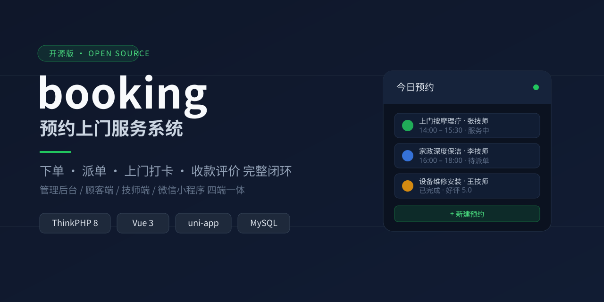

# booking · 预约上门服务系统（开源版）



> 一句话：一套覆盖「客户下单 → 派单/技师接单 → 上门打卡 → 完成/评价/收款」完整闭环的上门服务 / O2O 预约业务系统。基于 **ThinkPHP 8 + Vue 3 + uni-app**，同一个后端同时支撑 **管理后台 / H5 顾客端 / H5 技师端 / 微信小程序** 四个端。

## 适用场景
适合"人到现场"或"服务到家"的预约类生意，例如：上门按摩理疗、家政保洁、维修安装、美容美甲、宠物上门、设备巡检、私教/陪诊等。

## 开源版能做什么（免费核心，单店可直接跑真实业务）
- **客户自助预约**：选服务项目/规格、选时段、填地址、下单
- **订单全生命周期**：待派单 → 派单/接单 → 服务中（上门打卡签到）→ 完成 / 取消 / 爽约
- **技师与排班**：技师档案、可服务项目、排班与休息（含日历周视图）
- **收款与评价**：线下收款确认、支付流水、服务评价管理
- **会员与门店**：会员档案、地址簿、单门店、员工账号与角色权限
- **运营支撑**：系统设置（含登录安全策略）、操作日志、数据备份与升级
- **登录安全**：密码强度策略、连续失败锁定、异地登录提醒

## 特性亮点
- **多端一体**：一套后端 API 驱动 4 个端，避免重复开发
- **Open-core（开源核心）版本模型**：开源版即完整可用的核心；营销增长、会员资产、财务、多门店等增值能力属商业版，后台填卡密在线激活即解锁，**升级不丢数据、无需重装**
- **可直接对接**微信公众号 / 小程序、支付宝 / 微信支付（配置即用）
- **全中文**、目录清晰、注释完整，便于二次开发

## 技术栈
- 后端：PHP 8.0+ / ThinkPHP 8 / MySQL 5.7+
- 管理后台：Vue 3 + Vite + Element Plus
- 顾客端 / 技师端 / 小程序：uni-app（H5 + 微信小程序）

## 目录结构
```text
booking/
├── backend/     ThinkPHP 8 后端（controller / service / model / route / config）
├── frontend/
│   ├── admin/     管理后台（Vue 3 + Element Plus）
│   ├── user/      顾客端 H5
│   ├── mobile/    技师端 H5
│   └── miniapp/   微信小程序（uni-app）
├── data/sql/    建表脚本（01–19，安装向导按序自动导入，无需手动执行）
├── assets/      素材（客服二维码等）
└── LICENSE      MIT
```

## 快速开始
### 环境要求
- PHP ≥ 8.0（需 `pdo_mysql`、`mbstring`、`openssl` 扩展）
- MySQL ≥ 5.7
- Node ≥ 16（构建前端用）

### 后端
```bash
cd backend
composer install
cp .env.example .env      # 填写数据库等；密钥请在生产环境自行生成
php think run             # 本地开发，默认 http://127.0.0.1:8000
```
首次访问进入**安装向导**：检测环境 → 连接数据库 → 自动按序导入 `data/sql` 建表 → 创建管理员账号。

### 管理后台
```bash
cd frontend/admin
npm install
npm run dev               # 本地开发
npm run build             # 生产构建，产物在 dist/
```

### 顾客端 / 技师端 / 小程序
```bash
cd frontend/user   && npm install && npm run dev    # 顾客端 H5
cd frontend/mobile && npm install && npm run dev    # 技师端 H5
# 小程序：用 HBuilderX 打开 frontend/miniapp，运行到微信开发者工具
```

## 部署提示
- 生产环境 Nginx 站点根指向 `backend/public`；前端三端分别构建后部署到各自路径。
- 上线前务必：**关闭 debug**、修改默认管理员密码、`.env` 内密钥全部自行配置、数据库账号按最小权限授予。

## 安全
数据库口令、`jwt_secret`、支付密钥等一律通过 `.env` 配置（已在 `.gitignore` 内），**切勿提交到仓库**；请及时修改默认管理员密码。

## 版本与商业授权
开源版 = 完整可用的核心闭环。以下增值能力属商业版（**本仓库不含其源码**）：营销增长（优惠券 / 拼团 / 分销 / 自动化营销）、会员资产（储值 / 积分 / 卡券）、财务对账与提成、发票、多门店、电子服务协议、经营报表与导入导出等。需要**试用、报价、功能定制或部署代维**，可扫码添加客服微信（备注来意）：


## 许可
核心代码采用 [MIT](LICENSE) 许可；商业增值模块与品牌标识为另行授权内容。
